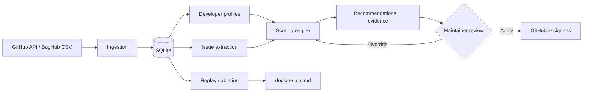

<div align="center">

# GitAssign

**Issue triage and developer recommendation for open-source repositories.**

GitAssign mines a repository's commit and issue history, builds per-developer
expertise profiles, and recommends the best person for each new issue — with
per-signal evidence, workload balancing, and a reproducible evaluation harness.

[](https://www.python.org/)
[](https://fastapi.tiangolo.com/)
[](https://react.dev/)
[](https://docs.docker.com/compose/)
[](LICENSE)

</div>

---

## Overview

Assigning issues manually does not scale. GitAssign turns repository history
into an explainable recommendation:

- **Who** has worked on similar issues, components, and files?
- **What evidence** supports the match?
- **Is the developer available**, or already at capacity?
- **How good** is the whole ranking compared with simpler baselines?

GitAssign is **decision support**, not an autonomous bot. A maintainer previews
every recommendation and its evidence, then explicitly applies or overrides it.
GitHub writes are opt-in.

> B.Tech Major Project — RCOEM Nagpur, CSE (AIML), Session 2026–27<br>
> Guide: **Dr. Rashmi Welekar** (Associate Head, CSE)

---

## Features

| Capability | Description |
| --- | --- |
| **History ingestion** | Imports issues, pull requests, commits, and contributors from GitHub or a BugHub CSV |
| **Developer profiles** | Builds expertise profiles from resolved issues and file-level commit history |
| **Seven-signal scoring** | Text similarity, past issues, components, file affinity, recency, workload, and AI domain fit |
| **AI triage (optional)** | Gemini classifies open issues and builds cached developer domain profiles; deterministic heuristics take over without a key |
| **Explainable rankings** | Every recommendation includes per-signal contributions and human-readable reasons |
| **Workload balancing** | Capacity-aware batch assignment with conflict checks |
| **Priority triage** | Rule-based Critical / High / Medium / Low classification with factor evidence |
| **Evaluation harness** | Time-based replay, TF-IDF baseline, and an A–E ablation study |
| **Demo workflow** | Upload a source file with `BUG-*` markers to exercise the full pipeline |
| **Safety first** | Preview by default; applying assignments to GitHub requires an explicit action |

Scoring is deterministic — no GPU, no model training, weights configurable at
runtime. An optional LLM layer (Gemini) handles issue classification and
developer domain profiles; its results are cached in SQLite and reused, and
without a key the pipeline completes using built-in keyword heuristics
(clearly labelled `model: heuristic` in the responses).

---

## How it works



1. **Ingest** issues, pull requests, and commits into a local SQLite database.
2. **Build profiles** that map each developer to components, files, and resolved
   issue history.
3. **Triage with AI (optional)** — Gemini classifies every open issue
   (bug / feature / docs … + domains) and builds an expertise profile per
   contributor; results are cached and never recomputed unless forced.
4. **Score** every candidate with configurable signals and a workload penalty.
5. **Explain** the ranking, then let a maintainer preview, apply, or override it.
6. **Evaluate** the model with a chronological replay and ablation study.

---

## Repository structure

```text
GitAssign/
├── backend/
│   ├── app/
│   │   ├── core/                 # Scoring, assignment, priority, explanations
│   │   ├── db/                   # SQLite connection, migrations, schema
│   │   ├── evaluation/           # Replay harness, TF-IDF baseline, ablation
│   │   ├── ingestion/            # GitHub fetcher, loaders, historical linker
│   │   └── main.py               # FastAPI application
│   ├── config/weights.json       # Tunable scoring weights
│   ├── scripts/load_bughub.py    # BugHub CSV loader
│   ├── tests/                    # API and core unit tests
│   ├── Dockerfile
│   ├── pytest.ini
│   └── requirements.txt
├── frontend/
│   ├── src/
│   │   ├── components/           # Dashboard views
│   │   │   └── ui/               # shadcn-style primitives
│   │   ├── lib/                  # Formatting, priority, and navigation helpers
│   │   ├── store/                # Redux Toolkit store + RTK Query API
│   │   ├── App.tsx
│   │   └── main.tsx
│   ├── Dockerfile
│   ├── nginx.conf                # SPA serving + /api reverse proxy
│   └── vite.config.ts
├── data/                         # Runtime SQLite DB and API cache (gitignored)
├── datasets/                     # BugHub CSV datasets
├── docs/results.md               # Generated ablation results
├── examples/                     # Demo fixture for the Demo Scan workflow
├── compose.yaml
├── .env.example
└── README.md
```

---

## Quick start

### Prerequisites

- [Docker](https://docs.docker.com/get-docker/) with Compose v2
- Optional: a GitHub token for higher API rate limits

### 1. Configure

```bash
cp .env.example .env
```

Set `GITHUB_TOKEN` in `.env` if you plan to ingest live repositories. Without a
token, GitHub allows 60 requests per hour; with one, 5,000.

### 2. Start the stack

```bash
docker compose up --build
```

| Service | URL |
| --- | --- |
| Dashboard | <http://localhost:3000> |
| API | <http://localhost:8000> |
| API docs (Swagger) | <http://localhost:8000/docs> |

Stop the stack with `docker compose down`.

### 3. Choose a workflow

#### Option A — Load a BugHub dataset (best for evaluation)

The Eclipse JDT dataset is included at `datasets/eclipse_jdt.csv`.

```bash
docker compose exec backend python scripts/load_bughub.py \
    datasets/eclipse_jdt.csv eclipse/jdt
```

Then in the dashboard:

1. Enter `eclipse/jdt` and click **Load Repo Data**.
2. Open **Developers** and click **Build Profiles**.
3. Open **Issues**, select the **all** or **closed** filter, and click an issue.
4. Review the top-5 recommendations and the evidence behind each signal.
5. Open **Metrics** and run the ablation study once profiles exist.

More datasets and download instructions are in [`datasets/README.md`](datasets/README.md).

#### Option B — Ingest a live GitHub repository

1. Enter a repository such as `pallets/click` in the sidebar.
2. Choose how many pages to fetch (start with 3–5), then click **Ingest from GitHub**.
3. Wait for the pipeline status to become **completed**.
4. Build profiles and review the issue queue.

New open issues are previewed for manual assignment. To assign automatically,
set `AUTO_ASSIGN_NEW_ISSUES=true` and provide a token with permission to modify
issues in the target repository.

#### Option C — Scan a demo file

Use the **Demo Scan** tab to upload [`examples/demo_buggy_service.py`](examples/demo_buggy_service.py).
GitAssign detects `BUG-*` markers, creates queued issues, and recommends a
historical developer when profiles exist. This is a deterministic demo fixture,
not a general static-analysis engine.

---

## Local development

Requires **Python 3.11+** and **Node.js 18+**.

### Backend

```bash
cd backend
python -m venv .venv
source .venv/bin/activate           # Windows: .venv\Scripts\activate
pip install -r requirements.txt
python -m app.db.init_db
uvicorn app.main:app --reload --port 8000
```

### Frontend

```bash
cd frontend
npm install
npm run dev
```

Open <http://localhost:3000>. Vite proxies `/api` to `http://localhost:8000`.

To serve the built dashboard directly from FastAPI, run `npm run build`; the
bundle is written to `backend/static/` and mounted by the API.

### Live issue sync

In development, the backend refreshes open issues for every loaded repository
once a minute. Set `LIVE_SYNC_INTERVAL_SECONDS=0` to disable polling, or raise
the interval to reduce GitHub API usage.

```bash
# Load a dataset from the backend/ directory
python scripts/load_bughub.py ../datasets/eclipse_jdt.csv eclipse/jdt
```

---

## Configuration

All settings are read from environment variables (or `.env`).

| Variable | Default | Description |
| --- | --- | --- |
| `GITHUB_TOKEN` | _empty_ | Personal access token for live ingestion and GitHub writes |
| `DB_PATH` | `data/gitassign.db` | SQLite database location |
| `CACHE_DIR` | `data/cache` | Raw GitHub API response cache |
| `WEIGHTS_PATH` | `config/weights.json` | Scoring weight configuration |
| `MAX_COMMIT_DETAILS` | `200` | Commit details fetched for file-affinity scoring |
| `LIVE_SYNC_INTERVAL_SECONDS` | `60` | Open-issue polling interval; `0` disables it |
| `AUTO_ASSIGN_NEW_ISSUES` | `false` | Automatically assign new issues during sync |
| `AUTO_ASSIGN_CAPACITY` | `3` | Minimum free capacity for automatic assignment |
| `AUTO_NOTIFY_DEVELOPER` | `false` | Mention the assignee in a GitHub comment |
| `GEMINI_API_KEY` | _empty_ | Enables LLM triage; empty = deterministic heuristic fallback |
| `GEMINI_MODEL` | `gemini-2.5-flash` | Gemini model used for classification and profiles |
| `LLM_ENABLED` | `true` | Master switch for the LLM layer (a key is still required) |
| `LLM_TIMEOUT_SECONDS` | `60` | Per-request timeout for `llm_client` |
| `LLM_MAX_RETRIES` | `3` | Retries on HTTP 429/5xx with exponential backoff |
| `LLM_MAX_ISSUES_PER_RUN` | `50` | Classified issues per analyze run (`0` = no cap) |
| `LLM_MAX_PROFILES_PER_RUN` | `100` | Domain profiles rebuilt per run (`0` = no cap) |

Scoring weights live in [`backend/config/weights.json`](backend/config/weights.json).
Edit the file and restart, or remount it with Compose — no retraining required.

---

## Scoring model

Each issue–developer pair receives a weighted score:

```text
S(i, d) = w1 · TextSimilarity
        + w2 · PastIssueSimilarity
        + w3 · ComponentOverlap
        + w4 · FileAffinity
        + w5 · Recency
        - w6 · CurrentWorkload
        + w7 · DomainMatch
```

| Weight | Default | Signal |
| --- | ---: | --- |
| `w1_text_similarity` | 0.30 | TF-IDF cosine similarity between issue text and resolved issues |
| `w2_past_issue_similarity` | 0.20 | Similarity to the developer's individual resolved issues |
| `w3_component_overlap` | 0.15 | Overlap between issue components and the developer's components |
| `w4_file_affinity` | 0.10 | Commit frequency on files mentioned in the issue |
| `w5_recency` | 0.05 | Time-decayed activity |
| `w6_workload_penalty` | 0.05 | Open assignments relative to `capacity_limit` (default `3`) |
| `w7_domain_match` | 0.15 | Overlap between the issue's AI domains and the developer's cached domain weights |

Set `w7_domain_match` to `0` in `weights.json` to reproduce the pre-AI ranking
exactly (also the default behaviour whenever a classification or domain cache
is missing, keeping old ablation numbers reproducible).

### Priority mapping

| Signal | Effect |
| --- | --- |
| `crash`, `blocker`, `P0`, `critical` labels | +4 → **Critical** |
| `bug`, `high`, `data-loss` labels | +2 → **High** |
| `enhancement`, `question` labels | −1 → **Low** |
| `crash` / `security` / `CVE` keywords | +2 / +3 |
| "steps to reproduce" in the body | +0.5 |

The result is a **Critical / High / Medium / Low** label plus a numeric score
and the list of factors that produced it.

### AI triage and caching guarantees

When `GEMINI_API_KEY` is set, two LLM artifacts are produced and cached:

| Artifact | Table | Key | Reuse rule |
| --- | --- | --- | --- |
| Issue classification (`kind`, domains, difficulty, severity) | `issue_classifications` | `(repo, issue_num)` + `input_hash` | Reclassified only when the issue title/body/labels, model, or prompt version changes, or `force=true` |
| Developer domain profile (domains, preferred kinds, summary) | `developer_domains` | `(repo, username)` | **Never** recomputed while a row exists; only `POST /api/pipeline/analyze` with `force: true` rebuilds |

Rules enforced by the pipeline:

- Only contributors with real history (commits or resolved issues) are
  profiled; `/contributors` entries with zero contributions and bots are
  ignored.
- Developers whose issues were closed as `not_planned` are not credited with
  resolving them, and the PR **author** — not the person who clicked merge —
  is recorded as the resolver.
- Every list/API read takes zero LLM calls; on-demand classification for one
  issue costs at most one (usually zero, cache hit).
- If the LLM fails or is disabled, deterministic heuristics fill in with
  `model: "heuristic"`; a failed LLM call is never cached as final.

---

## API reference

| Method | Endpoint | Description |
| --- | --- | --- |
| `GET` | `/api/health` | Health check |
| `GET` | `/api/repos` | List loaded repositories |
| `DELETE` | `/api/repos/{repo}` | Remove a repository's local data and cache |
| `GET` | `/api/issues?repo=&state=all` | Priority-sorted issues (`open` / `closed` / `all`) |
| `GET` | `/api/issues/{num}/recommendations?repo=` | Top-K developers with evidence |
| `POST` | `/api/assign/batch` | Preview workload-aware batch assignments |
| `POST` | `/api/assign/apply` | Apply previewed assignments and record results |
| `GET` | `/api/developers?repo=` | List developers |
| `GET` | `/api/developers/{user}/profile?repo=` | Full developer profile |
| `GET` | `/api/pipeline/status?repo=` | Background ingestion status |
| `POST` | `/api/pipeline/ingest` | Ingest a GitHub repository (background) |
| `POST` | `/api/pipeline/build-profiles` | Build profiles (background) |
| `POST` | `/api/pipeline/analyze` | AI triage: classify open issues + build domain profiles, cached (`{repo, force, max_issues}`) |
| `GET` | `/api/ai/status?repo=` | LLM reachability + cache coverage badge |
| `GET` | `/api/evaluation/metrics` | Latest ablation results |
| `POST` | `/api/evaluation/run` | Run the ablation study (background) |
| `POST` | `/api/demo/scan` | Scan a file for `BUG-*` markers and queue issues |

Interactive documentation: <http://localhost:8000/docs>.

---

## Evaluation

The evaluation harness replays issues chronologically. Each test issue is
scored using only developer history available before it was created; recency is
also measured as of that issue's creation date. Issues closed as `not_planned`
are excluded. If an issue links to multiple pull requests, every linked PR
author is treated as a relevant outcome. Top-k and MRR are calculated only for
issues where at least one relevant developer has historical profile evidence.
Results report eligible sample size and candidate coverage separately, so
cold-start issues are not counted as ranking errors. `train_before` sets the
earliest test issue creation date; `test_after` sets the closure-date boundary.
A TF-IDF baseline is available for comparison.

| Config | Signals enabled |
| --- | --- |
| A | Text similarity only |
| B | A + component overlap |
| C | B + file affinity |
| D | C + recency |
| E | All historically evaluable signals (workload and cached AI domains are omitted because historical states are unavailable) |

```bash
docker compose exec backend python -m app.evaluation.ablation_runner \
    eclipse/jdt 2009-01-01 2010-01-01 200
```

Results are written to [`docs/results.md`](docs/results.md) and displayed in the
**Metrics** tab. Compare ranking scores alongside coverage and eligible sample
size; ranking percentages alone do not show how often the system had evidence
to recommend someone.

---

## Testing

```bash
cd backend
pip install -r requirements.txt
pytest -v
```

Expected result: **45 tests passing**. CI runs the backend suite and the
frontend build on every push and pull request.

---

## Contributing

Contributions are welcome. Please read [`CONTRIBUTING.md`](CONTRIBUTING.md) for
the development workflow, commit conventions, and pull-request checklist.

For security issues, follow [`SECURITY.md`](SECURITY.md) instead of opening a
public issue.

---

## Tech stack

| Layer | Technologies |
| --- | --- |
| **Backend** | Python 3.11, FastAPI, SQLite, scikit-learn (TF-IDF), PyGithub, GitPython |
| **Frontend** | React 18, TypeScript, Vite, Redux Toolkit + RTK Query, Tailwind CSS, shadcn-style Radix primitives, lucide-react, Motion, Recharts |
| **Deployment** | Docker Compose, Nginx |

---

## Team

| Member | Phase | Ownership |
| --- | --- | --- |
| Amit Saw (A-09) | Phase 1 | Data ingestion, database, historical linker |
| Ankit Kolhe (A-10) | Phase 2 | Scoring engine, profiles, explanations |
| Annalhq Shaikh (A-13) | Phase 3 | Evaluation, replay harness, ablation |
| Himanshu Joshi (A-49) | Phase 4 | Dashboard, API, Docker, tests |
| Krish Ramchandani (A-56) | Phase 4 | Assignment engine, integration |

---

## License

Released under the [MIT License](LICENSE).

---

## References

1. M. Borg et al., "Adopting Automated Bug Assignment in Practice," *Empirical Software Engineering*, 2024.
2. G. Murphy and D. Cubranic, "Automatic Bug Triage Using Text Categorization," *SEKE*, 2004.
3. X. Xia et al., "Accurate Developer Recommendation for Bug Resolution," *WCRE*, 2013.
4. S. Mani et al., "DeepTriage," *CoDS-COMAD*, 2019.
5. A. M. Dakhel et al., "Dev2vec," *Information and Software Technology*, 2023.
6. C. Zhou et al., "IssueCourier," *arXiv:2505.11205*, 2025.
7. D. Artchounin, "Tuning Machine Learning for Automatic Bug Assignment," KTH thesis, 2017.
8. A. Lamkanfi et al., "Eclipse and Mozilla Defect Tracking Dataset," *MSR*, 2013.
